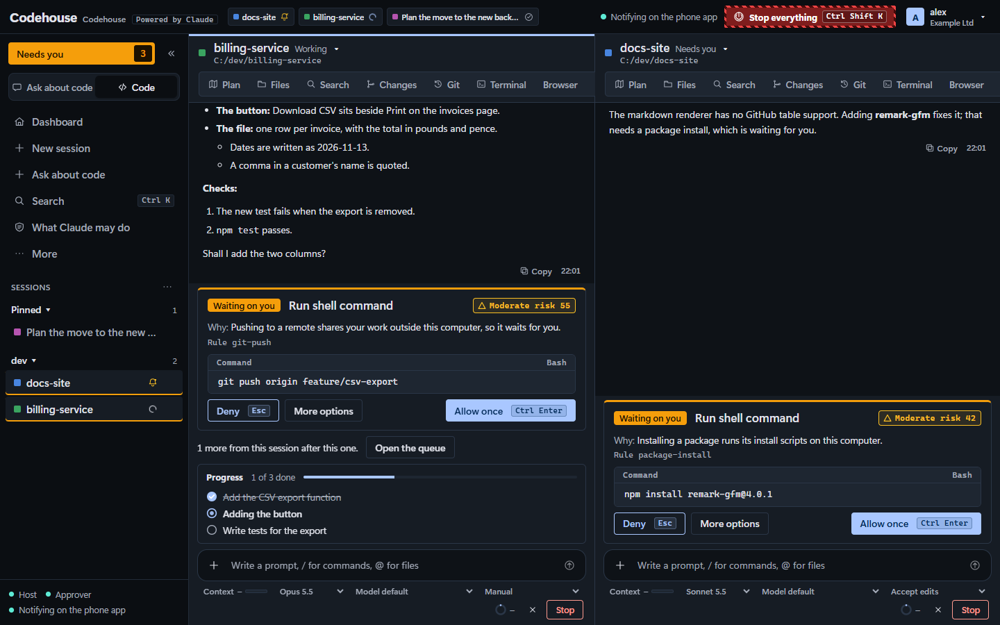
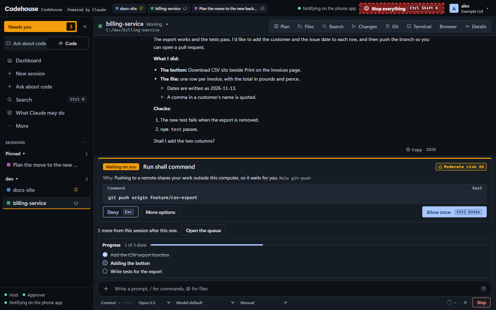
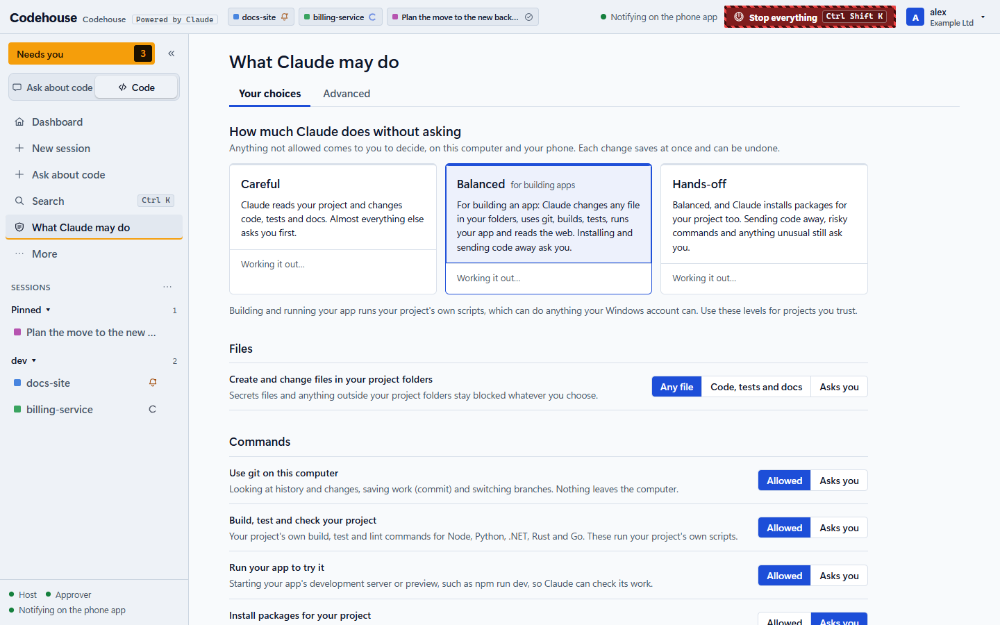
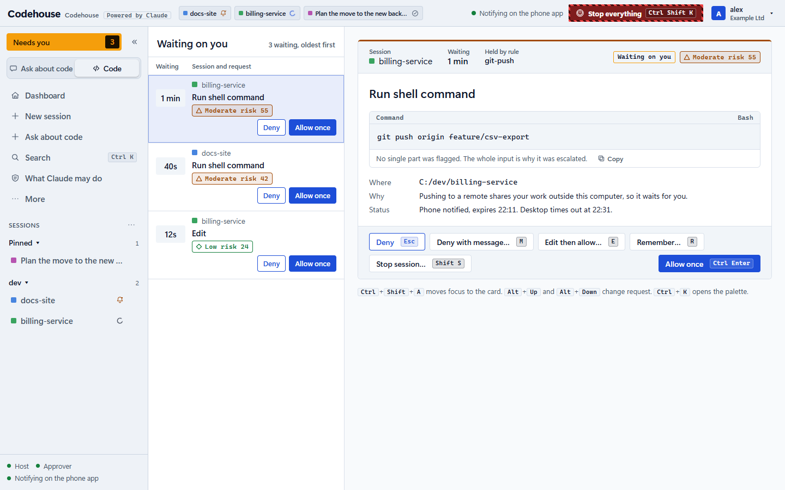
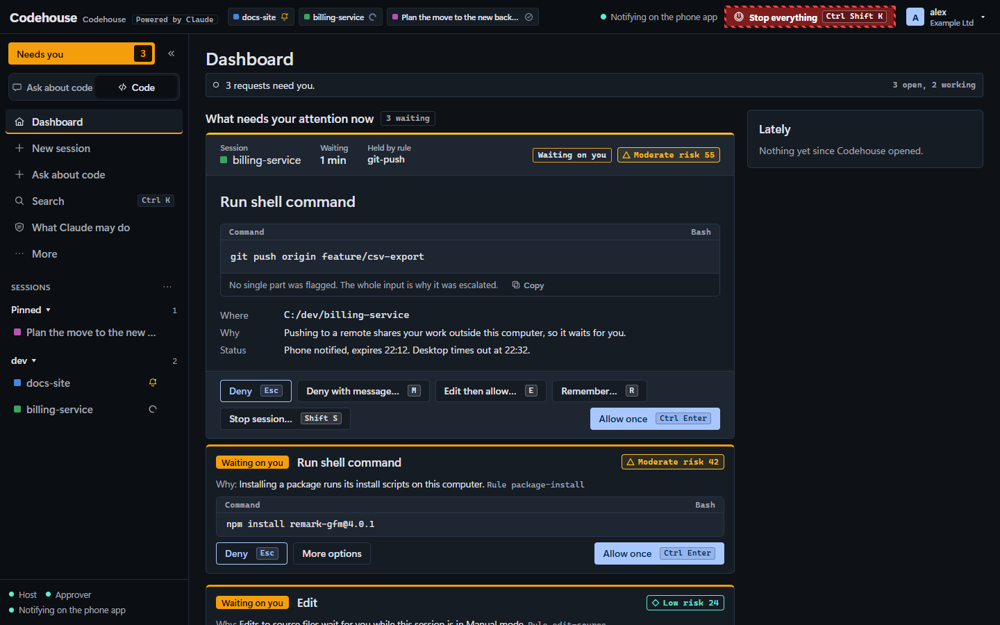
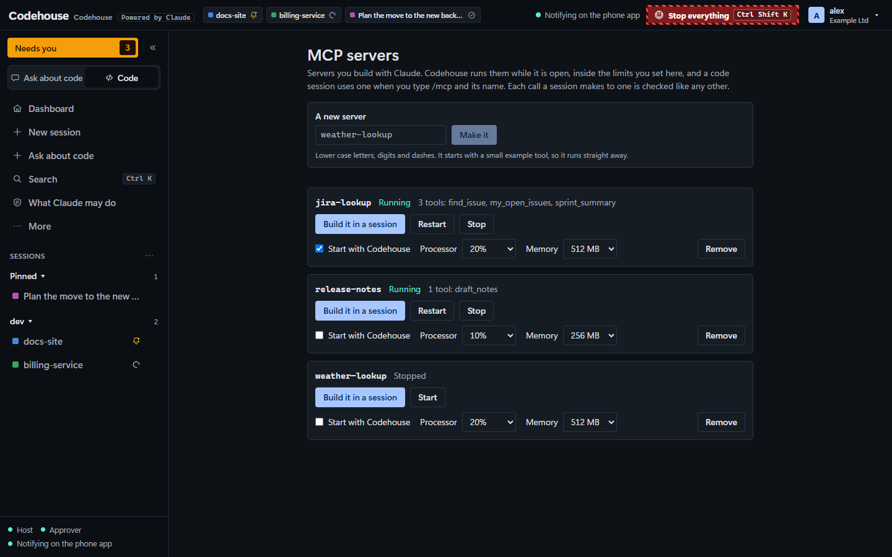
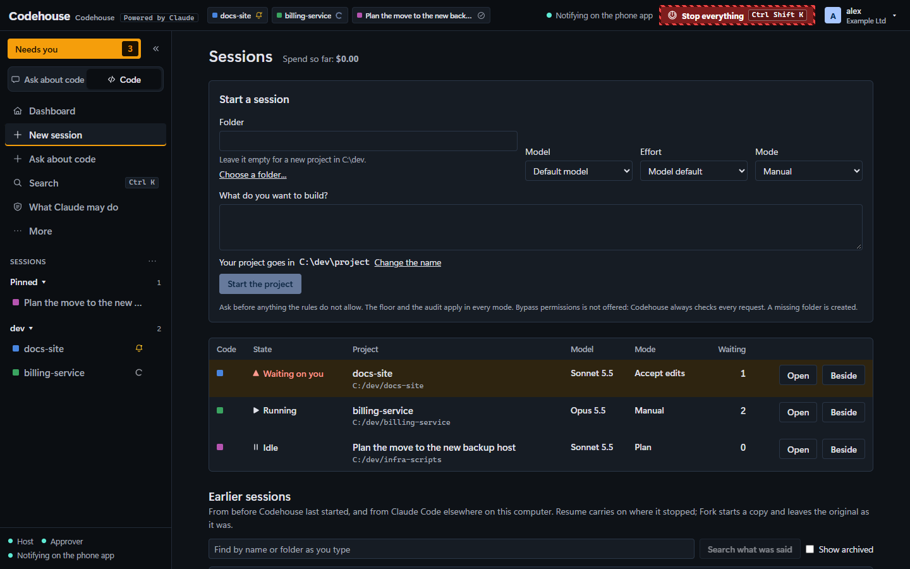
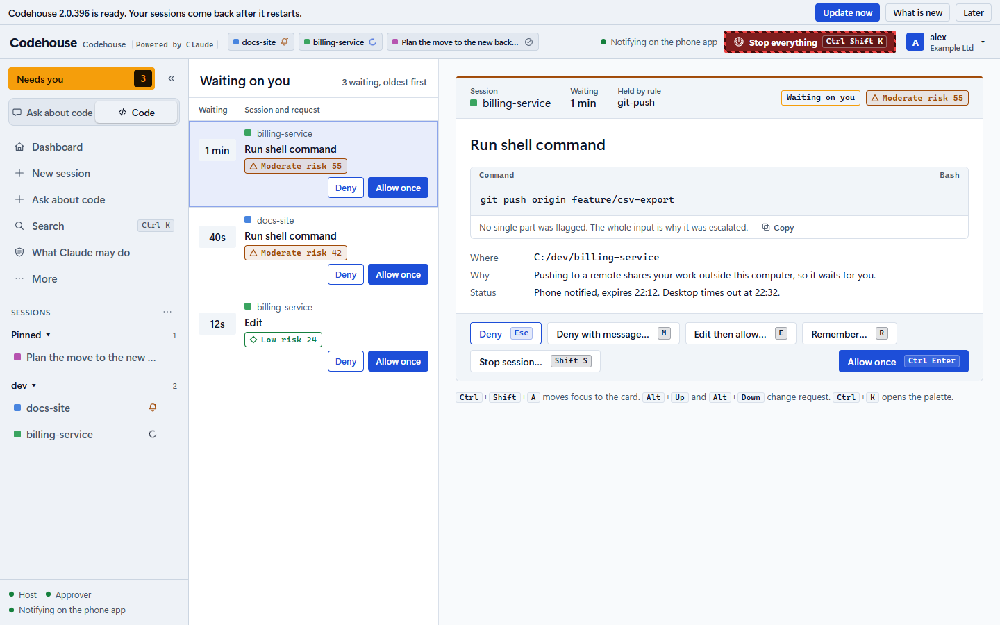

# Codehouse

**Run Claude agent sessions on your own computer, and stay in charge of what they do.**

Claude asks permission before it runs a command, edits a file or uses a tool. Codehouse answers the routine requests for you, by rules you can read and change. Anything it cannot be sure about waits for you, on this computer, on your phone and in your browser at the same time. Every decision, automatic or yours, goes into a tamper-evident audit log.

For Windows 10 and 11, and macOS. Powered by Claude.



## Why Codehouse

- **Fewer interruptions, not fewer checks.** Reading code, running the tests and `git status` go through on their own. A push, an install or a change outside your folders waits for you, with the exact command, the rule that held it and a risk score.
- **Rules you can read.** Choose Careful, Balanced or Hands-off in plain words, or set each switch yourself. Commands are parsed properly, so a safe command chained to a dangerous one is caught.
- **Answer from anywhere.** Approve on the desktop, on your iPhone with a passkey, through ntfy or Slack, or from any browser through Neighbourhood Watch, your own server that sees every computer's sessions.
- **Fail closed.** If anything goes wrong while deciding, the request waits for you. It is never allowed by mistake.
- **Everything on the record.** A hash-chained audit log, git checkpoints before risky steps, and a report of what was decided and what it cost.
- **Build your own tools.** Make MCP servers with Claude in Codehouse, run them inside the limits you set, and give them to a session with `/mcp`.

## Download

### Windows

For Windows 10 and 11 (64-bit). Download one:

- **[Codehouse-Setup-exe.zip](https://github.com/breakmylegs/gatehouse/releases/latest/download/Codehouse-Setup-exe.zip)**: the installer in a zip. Use this one if your browser will not keep a .exe download.
- **[Codehouse-Setup.exe](https://github.com/breakmylegs/gatehouse/releases/latest/download/Codehouse-Setup.exe)**: the installer on its own.

Then:

1. If you downloaded the zip, open it and run **Codehouse-Setup.exe** from inside it (or drag it out first).
2. If Windows says it protected your PC, choose **More info**, then **Run anyway**: the installer is not code-signed yet.
3. It installs Codehouse in your own Programs folder. You do not need administrator rights.
4. Open **Codehouse** from the Start menu. The setup wizard signs you in to Claude and checks your organisation.
5. Start a session on a scratch folder first, and watch what Codehouse decides.

You only run the installer once. After that Codehouse updates itself: see [Updates](#updates).

### macOS

The Mac app is built from this repository with `npm run package:mac` (it is signed on your Mac, not notarised, so the first time macOS asks once: choose **Open Anyway**). [docs/mac.md](docs/mac.md) has the steps and what differs on a Mac.

### Installing from the source

If you have this repository and Node, you can skip the installer: this builds what is in your copy and installs it in the same place as the installer, with a Start menu shortcut.

```
git clone https://github.com/breakmylegs/gatehouse.git
cd gatehouse
npm ci
npm run install:local
```

You need Node 24 and Git. Quit Codehouse from its tray icon before running it over a copy you already have: it then switches the way an update does, keeps your rules, and goes back by itself if the new copy does not start. Codehouse still updates itself from GitHub afterwards.

### What you need

- Windows 10 or 11, 64-bit, with Microsoft's WebView2 runtime (it is part of Windows 11), or a Mac.
- A Claude account you can use with Claude Code. Codehouse signs you in through Claude Code's own sign-in in your browser. It never sees your password and never reads your tokens.
- Nothing else. The PowerShell command checker uses PowerShell 7 (`pwsh`) when it is installed and the Windows PowerShell that comes with Windows otherwise.
- About 1.5 GB of disk: Codehouse is about 470 MB, and an update keeps the version before it so you can go back.

## What it does

### Sessions you can watch



- Your sessions sit in a sidebar, grouped by folder, with those that need you first, and in a strip across the top, most recently active first.
- **Start a new project from what you want to build.** Choose where new projects go in Settings, then say what you want: Codehouse names a folder from it, makes it a git repository and sends your words as the first prompt. Or start a session on a folder you choose.
- Pick the model, the effort and the mode under the prompt box: **Manual** (asks before edits and commands), **Plan**, **Accept edits**, **Auto**, or Max approval (below). Codehouse never uses the modes that skip permission checks.
- Watch up to four sessions side by side, each with its own transcript, plan, files, changes, git, terminal and browser panels, and prompt box. A line under the transcript says what Claude is doing and how long it has taken, and says so if a turn looks stuck.
- Runs of tool calls fold into one readable line ("Ran 2 commands, read schema.ts") that opens to each call.
- **Ask about code** opens a chat beside a session that reads its work and answers questions without changing anything. If it thinks the code session should do something, it offers the prompt, and you approve it by hand every time.
- Slash commands for the everyday: `/plan`, `/side` (a side question in Plan mode), `/clone`, `/publish`, `/mcp` and more, and the session's own commands and skills from the **+** menu.

### An Approver that decides by your rules

Every permission request goes to the **Approver**, which answers in this order:

1. **The floor.** Things that are never allowed, whatever any rule says: reading secrets and credentials, destructive commands, writing outside your folders.
2. **Deny rules**, then **decisions you asked it to remember**.
3. **Allow rules** for what is safe and routine: reading code, running the tests, `git status`.
4. **You**, for everything else.

Shell commands are parsed properly (Bash with tree-sitter, PowerShell with its own parser), so a safe command chained to a dangerous one is caught. Text from the web, from other servers or from files that are not your project's own is read for signs of prompt injection, and a command copied from it asks you. If anything goes wrong while deciding, the request waits for you.



**What Claude may do**, in plain words: choose Careful, Balanced (for building an app) or Hands-off, or set each switch yourself, such as letting Claude install packages for your project without asking. Every change saves at once and can be undone. It shows what is always blocked, offers rules learned from what you keep allowing, and answers "what would happen if Claude wanted to...". Under **Advanced**, the rule library has packs for git, package managers, build tools, running your app, the web, cloud command lines and containers. Switch packs on and off, write your own rules, and replay a change against your past decisions before you save it.

### You decide the rest, here or anywhere



- A request that needs you appears in its session, above the prompt box, with Allow once and Deny, and in the queue with the exact command or diff, the rule that held it, a risk score and why. Allow, deny, deny with a message, edit then allow (the edit is checked again), or remember the choice.
- After a run of approvals faster than anyone could read them, the next high-risk one asks you to look again before it can be allowed.
- Windows or macOS tells you when something is waiting, even with Codehouse closed to the tray, and a small wing at the top of the screen (beside the notch on a Mac) shows how many wait, with Deny and Allow once a click away.
- **On your iPhone:** pair it once with a passkey. Requests reach it end to end encrypted through a Relay that runs inside Codehouse or on a server of yours, and your answer only counts after Codehouse has checked the passkey signature. The phone app also shows your sessions and their transcripts, and can send a prompt or interrupt one.
- **Through ntfy or Slack:** a short, redacted summary with single-use Allow and Deny codes. Severe requests can never be allowed this way.
- The **kill switch** denies everything and stops new sessions at once.



### Max approval, for long unattended runs

Turn on Max approval for a session and it does not wait on you: questions get their recommended answer, plans are approved, and Codehouse carries on by itself after each turn until Claude says its work queue is empty, within the turn and spending limits you set.

- It approves every escalation a rule makes, whatever its risk.
- Floor denies stay denies, failures and a chat's hand-off still wait for you, and every automatic answer is in the audit log.
- Your organisation can turn it off. It is never kept as a new session's mode: you choose it each time.

### Codehouse Neighbourhood Watch

A small server you run yourself, with Docker on a mini server at home, that shows every computer's Codehouse sessions in one place, in a desktop browser, on a tablet or on your phone. From it you can see sessions, approve requests and send prompts, as you could at the computer.

- **Each computer dials out to it**, so nothing at home needs a port opened or forwarded. A computer pairs once with a ten-minute code and then proves itself with its own key.
- **Sign in** with a username and password, and add a passkey. An IP allow list can let your home network look without signing in, but changing the list, removing a computer or approving a Severe request always needs someone signed in.
- **Update it from its own page**: it takes only a release signed with Codehouse's release key, naming the exact commit to build.
- On each computer, the floor, the rules and the audit log still decide everything, and every command from Neighbourhood Watch is recorded with who sent it.

[docs/neighbourhood-watch.md](docs/neighbourhood-watch.md) has the docker compose stack and the steps.

### Build your own MCP servers



- **Make a server** by name. It starts with a small example tool, so it runs straight away.
- **Build it in a session**: a code session in its folder, told how Codehouse runs it. Servers that are already running are given to that session, so it can call them while it works.
- **Start, stop and restart** it, choose whether it **starts with Codehouse**, and set the most **processor and memory** it may use. Windows applies the limits to it and everything it starts.
- In any code session, type **/mcp** and the start of a name: Tab completes it, and the session can use that server's tools. Each call is checked by your rules like any other server's, and the server never sees your Claude sign-in.

### Everything on the record



- Each decision is written to an audit log in which every record carries the hash of the one before, so an edited or deleted record shows. Check it any time, with Codehouse or with a plain PowerShell script.
- Checkpoints: Codehouse snapshots your folder in git before risky steps, so you can look back and restore.
- Insights and usage: what was decided automatically, what waited for you, and what sessions cost.
- **Doctor** checks what Codehouse needs to work safely on this computer, each with what to do, and makes a report you can share that names no email address, token or file path of yours.

## Updates



- Codehouse looks for a new version every 30 minutes. Change that, or turn it off, in **Settings, Updates**.
- When one is out, an **Update** button appears in the header with what is new. Choose **Update now**: Codehouse closes, switches to the new version and opens again by itself, usually within a minute. Sessions that were working carry on where they were.
- It downloads only the parts that changed (usually a few megabytes), in the background, while you work.
- **Skip this version** and it is not offered again; a newer one still is. You can skip any number of versions and go straight to the newest.
- The version before is kept. **Go back** in Settings switches to it, and if a new version ever fails to start, Codehouse goes back by itself and tells you.
- Every update is signed. Codehouse refuses anything not signed with its release key, any download that does not match, and any address that is not GitHub's.

## Your data

- **Settings, audit log, usage and phone pairing** are in `%LOCALAPPDATA%\Gatehouse` on Windows and `~/Library/Application Support/Gatehouse` on a Mac. Updates never touch them. Secrets such as the Slack tokens are encrypted for your account.
- **Your rules** are in the install folder under `app\policy`, and are carried over on every update. Only the shipped rule library is replaced.
- Codehouse is in `%LOCALAPPDATA%\Programs\Codehouse`. Uninstall it from Windows Settings like any other app.

## Security, in short

- Everything Codehouse listens on is bound to this computer only (127.0.0.1) and needs a token, and it refuses requests from other web pages.
- Credentials are never read, logged or sent. Sign-in only ever happens in Claude Code's own flow, and the credential variables are taken out of everything a session or a server you built is started with.
- Text is redacted (your list of client names and the like) before anything is saved or sent.
- The phone Relay only ever holds ciphertext, and a phone answer counts only with a verified passkey signature.
- The threat model lists each attack Codehouse defends against and the test that proves it: [docs/threat-model.md](docs/threat-model.md).

## Build it yourself

You need Node 24, Git and, for the Windows installer, [Inno Setup 6](https://jrsoftware.org/isinfo.php).

```
npm ci
npm test
npm run package          builds dist-app\Codehouse\Codehouse.exe with its runtime
npm run package:check    the same, then starts it and checks it works
npm run installer        builds dist-app\Codehouse-Setup.exe
npm run package:mac      on a Mac: builds dist-app/Codehouse.app
```

`npm run release` publishes a release and `npm run release:cnw` a Neighbourhood Watch update (maintainers only: they need the release signing key and the GitHub CLI). [docs/packaging.md](docs/packaging.md) explains the package, the installer and how updates work.

The code is TypeScript (a Fastify Host, the Approver as an MCP server, a React interface) with a small native window that hosts the interface (WebView2 on Windows, WebKit on a Mac). Sessions run through the Claude Agent SDK. The screenshots here come from `scripts/screenshots.ts`, which draws the interface with sample data.

## Contributing

This repository does not take outside contributions; you are welcome to fork it. See [CONTRIBUTING.md](CONTRIBUTING.md).

## Credits

Codehouse is an independent project. It is not made or endorsed by Anthropic, or by the roadhouse Codehouse. Powered by Claude.
