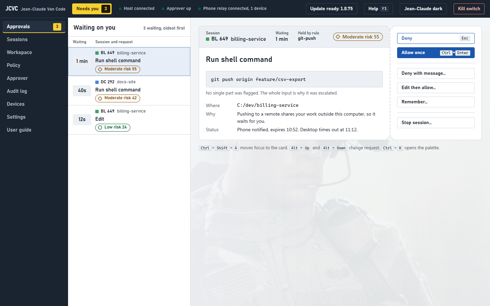
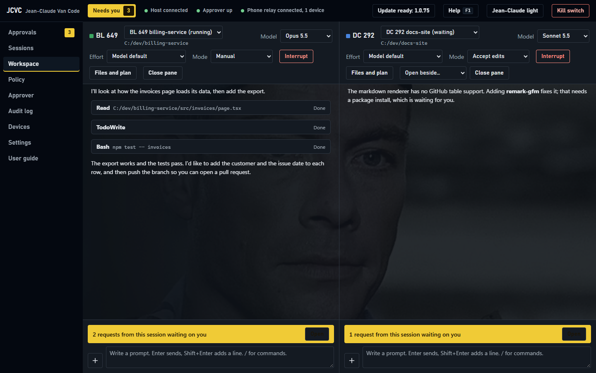
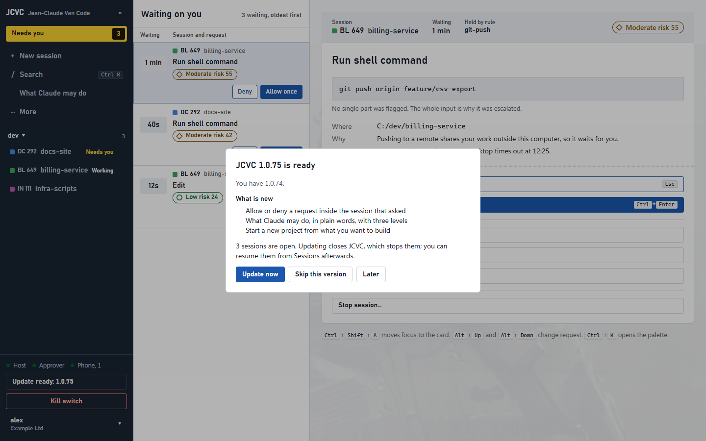
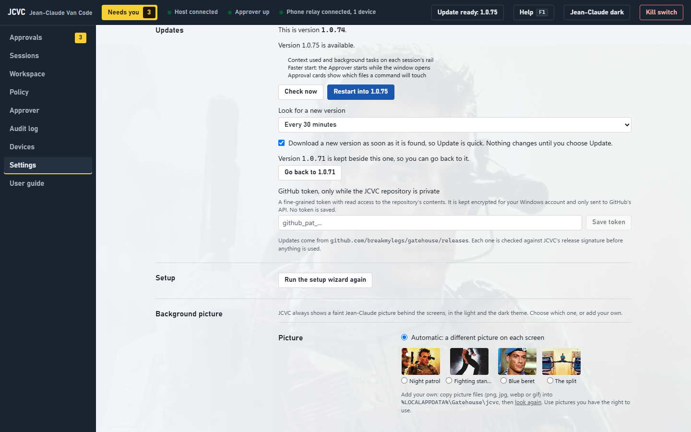

# Jean-Claude Van Code (JCVC)

**Run Claude agent sessions on your Windows computer, and stay in charge of what they do.**

Claude asks permission before it runs a command, edits a file or uses a tool. JCVC answers the routine requests for you, by rules you can read and change. Anything it cannot be sure about waits for you, on this computer and on your phone at the same time. Every decision, automatic or yours, goes into a tamper-evident audit log.



## Download

For Windows 10 and 11 (64-bit). Download one:

- **[JCVC-Setup-exe.zip](https://github.com/breakmylegs/gatehouse/releases/latest/download/JCVC-Setup-exe.zip)**: the installer in a zip. Use this one if your browser will not keep a .exe download.
- **[JCVC-Setup.exe](https://github.com/breakmylegs/gatehouse/releases/latest/download/JCVC-Setup.exe)**: the installer on its own.

Then:

1. If you downloaded the zip, open it and run **JCVC-Setup.exe** from inside it (or drag it out first).
2. If Windows says it protected your PC, choose **More info**, then **Run anyway**: the installer is not code-signed yet.
3. It installs JCVC in your own Programs folder. You do not need administrator rights.
4. Open **Jean-Claude Van Code** from the Start menu. The setup wizard signs you in to Claude and checks your organisation.
5. Start a session on a scratch folder first, and watch what JCVC decides.

You only run the installer once. After that JCVC updates itself: see [Updates](#updates).

### Installing from the source

If you have this repository and Node, you can skip the installer: this builds what is in your copy and installs it in the same place as the installer, with a Start menu shortcut.

```
git clone https://github.com/breakmylegs/gatehouse.git
cd gatehouse
npm ci
npm run install:local
```

You need Node 24 and Git. Quit JCVC from its tray icon before running it over a copy you already have: it then switches the way an update does, keeps your rules, and goes back by itself if the new copy does not start. JCVC still updates itself from GitHub afterwards.

### What you need

- Windows 10 or 11, 64-bit, with Microsoft's WebView2 runtime (it is part of Windows 11).
- A Claude account you can use with Claude Code. JCVC signs you in through Claude Code's own sign-in in your browser. It never sees your password and never reads your tokens.
- PowerShell 7 (`pwsh`) for the PowerShell command checker. Without it, PowerShell commands simply wait for you.
- About 1.5 GB of disk: JCVC is about 470 MB, and an update keeps the version before it so you can go back.

## What it does

### Sessions you can watch



- Start a session on a folder, with the model, the effort and the mode you choose: **Manual** (asks before edits and commands), **Plan**, **Accept edits** or **Auto**. JCVC never uses the modes that skip permission checks.
- Watch up to three sessions side by side, each with its own transcript, plan and task list, files and composer.
- See the files a session made or changed, browse its folder, and open files in a viewer (code, markdown, pictures, HTML) or a local dev server in a built-in browser.
- Add files, photos, folders, slash commands and skills from the **+** menu, or paste a picture into the prompt.

### An Approver that decides by your rules

Every permission request goes to the **Approver**, which answers in this order:

1. **The floor.** Things that are never allowed, whatever any rule says: reading secrets and credentials, destructive commands, writing outside your folders.
2. **Deny rules**, then **decisions you asked it to remember**.
3. **Allow rules** for what is safe and routine: reading code, running the tests, `git status`.
4. **You**, for everything else.

Shell commands are parsed properly (Bash with tree-sitter, PowerShell with its own parser), so a safe command chained to a dangerous one is caught. If anything goes wrong while deciding, the request waits for you. It is never allowed by mistake.

The **rule library** has packs for git, package managers, build tools, cloud command lines, file edits, the web, PowerShell and MCP servers. Switch packs on and off, write your own rules, and replay a change against your past decisions before you save it.

### You decide the rest, here or on your phone

- A request that needs you appears on the board with the exact command or diff, the rule that held it, a risk score and why. Allow, deny, deny with a message, edit then allow (the edit is checked again), or remember the choice.
- Windows tells you when something is waiting, even with JCVC closed to the tray.
- **On your iPhone:** pair it once with a passkey. Requests reach it end to end encrypted through a Relay that runs inside JCVC or on a server of yours, and your answer only counts after JCVC has checked the passkey signature.
- **Through ntfy or Slack:** a short, redacted summary with single-use Allow and Deny codes. Severe requests can never be allowed this way.
- The **kill switch** denies everything and stops new sessions at once.

### Everything on the record

- Each decision is written to an audit log in which every record carries the hash of the one before, so an edited or deleted record shows. Check it any time.
- Checkpoints: JCVC snapshots your folder in git before risky steps, so you can look back and restore.
- Insights and usage: what was decided automatically, what waited for you, and what sessions cost.

## Updates



- JCVC looks for a new version every 30 minutes. Change that, or turn it off, in **Settings, Updates**.
- When one is out, an **Update** button appears in the header with what is new. Choose **Update now**: JCVC closes, switches to the new version and opens again by itself, usually within a minute.
- It downloads only the parts that changed (usually a few megabytes), in the background, while you work.
- **Skip this version** and it is not offered again; a newer one still is. You can skip any number of versions and go straight to the newest.
- The version before is kept. **Go back** in Settings switches to it, and if a new version ever fails to start, JCVC goes back by itself and tells you.
- Every update is signed. JCVC refuses anything not signed with its release key, any download that does not match, and any address that is not GitHub's.



## Your data

- **Settings, audit log, usage and phone pairing** are in `%LOCALAPPDATA%\Gatehouse`. Updates never touch them. Secrets such as the Slack tokens are encrypted for your Windows account.
- **Your rules** are in the install folder under `app\policy`, and are carried over on every update. Only the shipped rule library is replaced.
- JCVC is in `%LOCALAPPDATA%\Programs\JCVC`. Uninstall it from Windows Settings like any other app.

## Security, in short

- Everything JCVC listens on is bound to this computer only (127.0.0.1) and needs a token, and it refuses requests from other web pages.
- Credentials are never read, logged or sent. Sign-in only ever happens in Claude Code's own flow.
- Text is redacted (your list of client names and the like) before anything is saved or sent.
- The threat model lists each attack JCVC defends against and the test that proves it: [docs/threat-model.md](docs/threat-model.md).

## Build it yourself

You need Node 24, Git and, for the installer, [Inno Setup 6](https://jrsoftware.org/isinfo.php).

```
npm ci
npm test
npm run package          builds dist-app\JCVC\JCVC.exe with its runtime
npm run package:check    the same, then starts it and checks it works
npm run installer        builds dist-app\JCVC-Setup.exe
```

`npm run release` publishes a release (maintainers only: it needs the release signing key and the GitHub CLI). [docs/packaging.md](docs/packaging.md) explains the package, the installer and how updates work.

The code is TypeScript (a Fastify Host, the Approver as an MCP server, a React interface) with a small C# window that hosts the interface in WebView2. Sessions run through the Claude Agent SDK.

## Contributing

This repository does not take outside contributions; you are welcome to fork it. See [CONTRIBUTING.md](CONTRIBUTING.md).

## Credits

JCVC is an independent project. It is not made or endorsed by Anthropic, or by Jean-Claude Van Damme. Powered by Claude.
